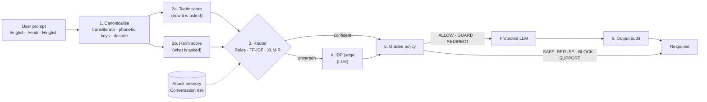

# KAVACH

**A model-agnostic, intent-aware jailbreak defence layer for LLMs, with first-class support for Hindi and code-mixed Hinglish.**

KAVACH (Sanskrit/Hindi for *armour*) sits between users and any large language model. It analyses the intent behind each prompt, detects jailbreak attempts written in English, Devanagari Hindi or romanized Hinglish, and responds with a **graded action** instead of a binary allow/refuse decision, so the protected model stays useful for legitimate requests.

---

## Contents

1. [Approach](#approach)
2. [Architecture](#architecture)
3. [Results](#results)
4. [Installation](#installation)
5. [Configuration](#configuration)
6. [Usage](#usage)
7. [Reproducing the experiments](#reproducing-the-experiments)
8. [Repository structure](#repository-structure)
9. [Limitations and ethics](#limitations-and-ethics)

---

## Approach

| Component | Idea |
|---|---|
| **Tactic/harm decoupling** | A jailbreak is modelled as a harmful *goal* wrapped in an evasion *tactic*. The two are scored independently, so role-play or "ignore the formatting" prompts with benign goals are answered, while a harmful goal combined with a tactic is blocked. |
| **Canonicalize-then-judge** | Devanagari→Roman transliteration, Hinglish phonetic keys and de-obfuscation (base64, leetspeak, homoglyphs, zero-width characters) map three writing forms of Hindi into one analysable representation. |
| **Intent Decomposition Prompting (IDP)** | The LLM judge translates the prompt, strips the framing, rates the bare *core request* separately from the tactics, and proposes a safe rewrite. User text is fenced inside an HMAC-derived nonce to resist injection against the judge. |
| **Learned router** | A fine-tuned XLM-R (278M parameters) decides which prompts need the LLM judge, replacing the hand-written router in the cost-saving cascade. |
| **Graded policy** | Six actions: `ALLOW`, `GUARD` (hardened system prompt), `REDIRECT` (answer a safe rewrite), `SAFE_REFUSE`, `BLOCK`, and `SUPPORT` (empathetic reply with a helpline), returned in the user's language. |
| **Adaptivity without retraining** | An attack memory of judge-confirmed jailbreaks and a decayed conversation-risk score that counters multi-turn escalation. |

## Architecture



| Stage | Module | Cost |
|---|---|---|
| Canonicalization | `kavach/normalize.py` | < 10 ms, CPU |
| Tactic and harm scoring | `kavach/tactics.py`, `kavach/harm.py` (rules in `kavach/resources/*.json`) | < 10 ms, CPU |
| Routing | `kavach/guard.py` (rules), `kavach/router.py` (TF-IDF / XLM-R) | XLM-R ≈ 60–90 ms on CPU |
| IDP judge and output audit | `kavach/judge.py` | one LLM call, only when escalated |
| Graded policy | `kavach/policy.py` | negligible |
| Attack memory, conversation risk | `kavach/memory.py` | negligible |

## Results

All data are public (AdvBench, XSTest, MultiJail, in-the-wild jailbreaks, inspect-india-evals). Thresholds were tuned on a 30% dev split; all numbers below are on the held-out 70% test split. Full tables are in the paper.

| Finding | Result | Evidence |
|---|---|---|
| Over-refusal of benign real-user prompts | tactic-only detector 11.1% → **KAVACH 0.2%** | `bench/results/test_offline.json` |
| Ablation: remove Devanagari transliteration | Hindi routing recall 64.3% → **0%** | `bench/results/test_offline.json` |
| IDP judge vs naive yes/no judge (Gemini 3.5 Flash-Lite), harmful refused | **81.2%** vs 80.9%, both with 0% false refusals | `bench/results/test_llm.json` |
| ... on India-specific harms / multi-turn / romanized Hindi | **88.1 / 95.2 / 75.0%** vs 73.8 / 85.7 / 50.0% | `bench/results/test_llm.json` |
| XLM-R router vs rule router: harmful / benign sent to judge | **95.0% / 15.9%** vs 71.8% / 38.2% | `dl/report/router_results.json` |
| Generalisation to an unseen source (trained without India-safety) | XLM-R **49.2%**, MuRIL 47.6%, TF-IDF 13.2% | `dl/report/loso_table.tex` |
| Cascade refusal rate, learned router vs rule router | **74.4–79.5%** vs 62.4% | `bench/results/test_llm_router_*.json` |

## Installation

**Requirements:** Python ≥ 3.9 (tested on 3.10 and 3.13). A GPU is not required.

```bash
git clone https://github.com/genomecrafter/Kavach.git
cd Kavach
python -m pip install --upgrade pip setuptools
python -m pip install -e ".[all]"            # core, server, evaluation
python -m pip install torch transformers     # optional: XLM-R router
```

**XLM-R router weights (optional).** `dl/best_router/model.safetensors` (556 MB) is distributed as a release asset because it exceeds GitHub's file-size limit. Download it from the [Releases page](https://github.com/genomecrafter/Kavach/releases) and place it in `dl/best_router/`. Everything else in that folder (config, tokenizer, metrics) is already in the repository. Without the weights, KAVACH runs with the rule-based and TF-IDF routers.

## Configuration

API keys are read from a `.env` file in the repository root. The file is git-ignored.

1. Copy the template: `cp .env.example .env` (Windows: `copy .env.example .env`).
2. Open `.env` in any editor and set your key:
   ```ini
   GEMINI_API_KEY=your-key-here
   ```
   A free Gemini key is available from [Google AI Studio](https://aistudio.google.com/apikey).

| Variable | Used for | Required |
|---|---|---|
| `GEMINI_API_KEY` | Gemini, the default provider | for `--provider gemini` |
| `GROQ_API_KEY`, `OPENAI_API_KEY` | alternative OpenAI-compatible providers | only if selected |
| `KAVACH_RPM` | client-side requests-per-minute cap | no |

The server, `bench/run_llm.py` and `dl/cascade_eval.py` load `.env` automatically.

## Usage

### Web demo (runs locally)

The demo is not hosted publicly; it runs on your machine and calls the LLM provider with your own API key.

```bash
python -m kavach.server                     # Gemini (default provider), http://localhost:8000
python -m kavach.server --provider mock     # offline: no key, rule-based mode only
```

| Control | Function |
|---|---|
| **Router** (header): `Rules · TF-IDF · XLM-R` | Switches the routing model live. Learned routers load on first selection (XLM-R ≈ 5–15 s on CPU); unavailable options are disabled, with the reason shown on hover. |
| **Mode**: `Cascade · Always judge · Rules only` | When the LLM judge is consulted. |
| **Compare with unprotected model** | Shows the raw model's answer next to KAVACH's. |
| **Decision inspector** | Click any reply to inspect every stage: canonical text, tactics, harm score, router probability vs threshold, the judge's core request and safe rewrite, the policy, and the output audit. |
| **Examples** | Benign demo prompts and random prompts drawn from the benchmark datasets, including multi-turn attacks replayed turn by turn. |
| **Results** | The paper's results as charts. |

Useful server options: `--router rules|tfidf|xlmr` (initial router), `--mode cascade|judge|heuristic`, `--provider gemini|groq|openai|ollama|mock`, `--port 8000`. Windows users can also use `scripts\run_demo.ps1`, which installs the XLM-R dependencies if needed and opens the browser.

### OpenAI-compatible proxy

The demo server also exposes `/v1/chat/completions`, so an existing application can be protected by changing only its base URL:

```python
from openai import OpenAI
client = OpenAI(base_url="http://localhost:8000/v1", api_key="unused")
client.chat.completions.create(model="any", messages=[{"role": "user", "content": "..."}])
```

Each response includes a `kavach` field with the action, scores and language.

### Python library

```python
from kavach import Kavach, OpenAICompatLLM
from kavach.router import LearnedRouter

llm = OpenAICompatLLM.from_preset("gemini")          # reads GEMINI_API_KEY
guard = Kavach(llm=llm, judge_llm=llm, mode="cascade",
               router=LearnedRouter("dl/best_router"))  # or "dl/runs/tfidf", or omit for rules

reply, decision = guard.chat([{"role": "user", "content": "Phishing se apne parivaar ko kaise bachaye?"}])
print(decision.action, decision.harm, decision.tactic, decision.trace["router_prob"])

@guard.protect                                       # wrap any existing fn(messages) -> str
def my_bot(messages, **kw): ...
```

See `examples/quickstart.py`. Run the tests with `python -m pytest -q tests`.

## Reproducing the experiments

| # | Step | Command | Requirements |
|---|---|---|---|
| 1 | Build the benchmark (pre-built in `bench/data/`) | `bash bench/download.sh && python bench/build_bench.py` | internet |
| 2 | Model-free systems and ablations | `python bench/evaluate.py --split test --tag test_offline` | CPU, ≈ 3 min |
| 3 | LLM-judge experiments | `python bench/run_llm.py` | API key; ≈ 1 h on the Gemini free tier |
| 4 | Train routers (XLM-R, MuRIL, DistilmBERT; TF-IDF baseline) | run `dl/kaggle/kavach_router_kaggle.ipynb` on Kaggle (2× T4) | GPU, ≈ 45 min |
| 5 | Router analysis and figures | `python dl/analyze.py` | CPU |
| 6 | End-to-end cascade with a learned router | `python dl/cascade_eval.py --router dl/best_router --label xlmr` | none (served from cache) |
| 7 | Regenerate the paper tables | `python bench/make_tables.py` | none |

**Reproducibility.** Every Gemini response from the published run is cached in `bench/results/llm_cache.sqlite`. Together with `bench/results/nonce_key.txt`, steps 3 and 6 replay that run without new API calls. The nonce key only reproduces the judge's prompt fence for this cache; in normal operation a random key is generated at start-up. The console log of the published run is in `bench/results/run_llm_gemini.log`.

## Repository structure

```
kavach/                     core library
├── normalize.py            canonicalization: transliteration, phonetic keys, decoding
├── tactics.py · harm.py    tactic and harm scoring (rules in resources/*.json)
├── judge.py                Intent Decomposition Prompting judge and output auditor
├── router.py               learned routers (XLM-R / TF-IDF)
├── policy.py · memory.py   graded policy; attack memory and conversation risk
├── guard.py                the Kavach guard
├── llm.py                  OpenAI-compatible clients (Gemini, Groq, OpenAI, Ollama), response cache
├── server.py · web/        OpenAI-compatible proxy and live demo UI
bench/                      benchmark construction, evaluation, LLM runner, table generation
├── data/                   dev / test splits built from public datasets
└── results/                result files, Gemini response cache, run log
dl/                         deep-learning router
├── train_router.py · tfidf_baseline.py · analyze.py · cascade_eval.py · data.py
├── kaggle/                 training notebook (template and executed run)
├── runs/ · report/ · logs/ per-run metrics, figures, training logs
└── best_router/            XLM-R router used by the demo (weights via Releases)
paper/                      IEEE conference paper: main.tex, refs.bib, tables/, figures/
scripts/                    demo launchers (Windows / Unix)
examples/ · tests/
```

## Limitations and ethics

**Limitations**

- The LLM evaluation uses a stratified sample of 186 prompts and a single judge model.
- Romanized-Hindi test data is machine-transliterated rather than user-written.
- Tamil, Telugu and Bengali have no dedicated canonicalizer; prompts in those scripts are escalated straight to the judge.
- Learned routers are strongest in-distribution; on unseen sources, combining rules with the model (`union`, the default) is safest.

**Ethics.** The repository contains no newly authored attack prompts. All harmful prompts come from existing research datasets (AdvBench, XSTest, MultiJail, jailbreak_llms, inspect-india-evals), and the derived variants only change script and spelling. Model output in the demo is HTML-escaped before rendering.

